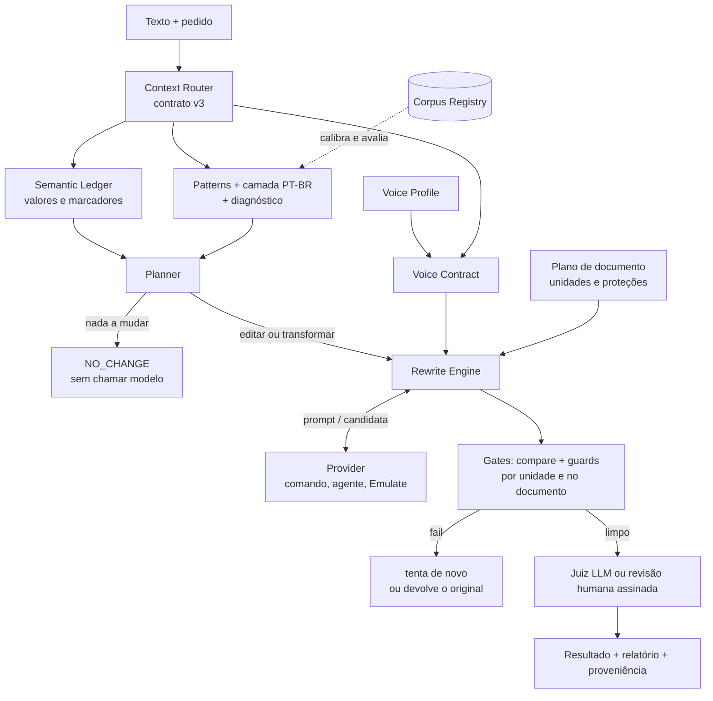

# VozNativa

**Reescrita de texto em português brasileiro que preserva o que o texto diz e verifica isso antes de entregar.**

VozNativa ajusta um texto à voz do autor, ao canal e ao público e confere com gates determinísticos os invariantes que sabe verificar: números, datas, negações, condições, modalidade, nomes, e sinais de ação ou compromisso perdidos. Os gates não provam que o sentido foi mantido. Quando acham um problema, a candidata é reprovada ou vai para revisão; quando não acham nenhum, o resultado continua `unverified` até um juiz ou uma pessoa confirmar. Se nada passa, o engine devolve o original. Funciona como **Agent Skill** (Claude Code, Codex, Gemini CLI e outros hosts que leem `SKILL.md`) e como **pacote Python com CLI**.

> Pergunta que guia o projeto: *como esta pessoa escreveria este conteúdo, neste canal, para este público, sem perder fatos, intenção ou registro?*

| Para quem | Para quê |
|---|---|
| quem escreve em PT-BR com ajuda de modelos | tirar fórmulas ("É importante destacar que…") sem mudar o sentido |
| quem integra LLMs em produtos e agentes | um gate que reprova reescritas que alteram valores, negação, modalidade ou condições |
| quem revisa documentos longos | reescrita por seções com validação do documento inteiro |
| quem pesquisa PT-BR | registro de corpora com licença por operação, benchmarks congelados, avaliação fora de distribuição |

**Estado:** `0.7.0.dev1` (estabilização da `0.7.0.dev0`), em desenvolvimento, não publicado no PyPI e sem release estável. O que é implementado, parcial ou não executado está na tabela [Funcionalidades](#funcionalidades).

## Em 30 segundos

Um texto com duas fórmulas vazias e uma restrição de orçamento ([`examples/quickstart/original.txt`](examples/quickstart/original.txt)):

> É importante destacar que o relatório trimestral será enviado até sexta-feira, 14/11/2025. Vale ressaltar que o orçamento não pode ultrapassar R$ 12.000,00.

Três candidatas de reescrita, checadas pelo gate (saídas reais desta versão):

| Candidata | `voznativa compare` | Por quê |
|---|---|---|
| "O relatório trimestral será **encaminhado** até sexta-feira, 14/11/2025. O orçamento **não** pode passar de R$ 12.000,00." | `no_deterministic_issues` (exit 3) | valores, negação e ação mantidos. Isso **não** certifica a equivalência: o relatório diz `semantic_equivalence: unverified` e registra a troca de verbo (`predicate_replaced`, informativo) para um juiz ou uma pessoa confirmar |
| "O relatório trimestral será encaminhado até sexta-feira, 14/11/2025. O orçamento pode passar de R$ 12.000,00." | `fail` (exit 1), `negation_changed` crítico | a negação sumiu |
| "O relatório trimestral **vai até** sexta-feira, 14/11/2025. O orçamento não pode passar de R$ 12.000,00." | `review_required` (exit 2), `predicate_missing` | valores e negação ficaram, mas a ação de enviar sumiu: sobrou só um verbo leve. É um sinal de risco para revisão, não uma prova de erro |

Dentro do `rewrite`, uma candidata que falha nunca é entregue: depois das tentativas, o engine devolve o **original** com `returned_original`.

## Funcionalidades

| Grupo | O que faz | Estado |
|---|---|---|
| **Semantic Ledger e `compare`** | inventário de valores (números por extenso, datas, horas, dinheiro, versões, caminhos), negação, modalidade, quantificadores, condições, causalidade, atribuição, papéis agente/paciente; mudanças dentro de uma frase e entre frases e parágrafos (negação deslocada, frase que retoma a anterior movida, frase curta acrescentada) | IMPLEMENTED; pronomes e correferência: NOT_IMPLEMENTED |
| **Context Router (contrato v3)** | 14 dimensões (gênero, canal, registro, época do texto, variedade, estrutura, público…) com valor, fonte e confiança; abstém-se (`unknown`) em vez de chutar e mantém proteções conservadoras | IMPLEMENTED |
| **Planner e Rewrite Engine** | decide por frase o que manter, cortar ou reescrever; não chama o modelo quando não há o que mudar (`NO_CHANGE`); valida, tenta de novo, devolve o original se nada for seguro | IMPLEMENTED |
| **Documentos longos** | `rewrite --long-form`: unidades sem perda, código/tabelas/citações/verso nunca enviados ao modelo, nomes e siglas carregados entre unidades, validação global e reversão de unidades que quebram o documento | IMPLEMENTED (provedores reais: só testado com stub) |
| **Pattern Library e camada PT-BR** | 27 padrões editoriais por gênero e posição; PT-PT × PT-BR (falsos amigos não trocados às cegas; grafia anterior à reforma ortográfica não é PT-PT) | IMPLEMENTED; limiares calibrados só em parte |
| **Análise verbal** | tempo, modo, pessoa e perífrases por regras, com abstenção; sinaliza mudança de tempo verbal na reescrita | IMPLEMENTED (93–97% de acerto nas análises únicas, medido contra Universal Dependencies) |
| **Diagnóstico do original** | `diagnose`: erro formal, contradição interna, escolha legítima, licença literária, ambiguidade; modos `PRESERVE`, `REVIEW`, `PROOFREAD`, `POLISH`, `ADAPT` | IMPLEMENTED (base) |
| **Voice Profile e Voice Contract** | hábitos do autor por canal, sem guardar texto | IMPLEMENTED; limiares sem calibração com amostras reais |
| **Gíria, comunidade, região** | mantém a gíria do autor e o sentido pelo contexto ("de boa qualidade" não é gíria); nunca acrescenta gíria, termo de comunidade ou regionalismo sem evidência | IMPLEMENTED; packs regionais e de comunidade em estado piloto/E0 |
| **Corpus Registry** | 38 fontes; 7 integradas à avaliação (notícia, blog, acadêmico, tweets, avaliações, literatura do séc. XIX, traduções); política de dados por operação | IMPLEMENTED |
| **Integridade e proveniência** | `integrity`: caracteres invisíveis, bidi, tags, homóglifos; cada `rewrite` devolve um registro de proveniência sem o texto | IMPLEMENTED; não detecta nem remove marca d'água estatística |
| **Benchmarks e assurance** | suítes congeladas, `ptbr-bench-v5` fora de distribuição, qualificação local, evidência de CI vinculada ao SHA | IMPLEMENTED; braços com modelo e revisão humana: NOT_RUN |
| **Benchmark de detectores de IA** | adapters e protocolo H0/H1/A0/A1 para *medir* detectores, nunca para contorná-los | infraestrutura IMPLEMENTED; execução real: NOT_RUN |

## Como funciona



Em texto: o **Router** monta o contrato de contexto; o **Ledger** extrai o que não pode mudar; padrões e diagnóstico dizem o que soa como fórmula ou erro; o **Planner** decide se há algo a fazer; o **Engine** chama o provider só quando precisa, valida cada candidata com o `compare` e os guards (por unidade e, em documentos longos, no documento inteiro) e devolve o original quando nada passa. Passar nos gates **não** prova equivalência: o melhor resultado sem juiz é `needs_judgment`.

## Instalação

Requer Python 3.11+ (testado em 3.11, 3.12 e 3.13 no Windows e no Linux). A única dependência obrigatória é PyYAML. O pacote não está no PyPI; instale a partir do repositório.

**Windows (PowerShell)**

```powershell
git clone https://github.com/Soturine/VozNativa.git
cd VozNativa
python -m venv .venv
.\.venv\Scripts\Activate.ps1
python -m pip install .
voznativa --version
```

**Linux / macOS**

```bash
git clone https://github.com/Soturine/VozNativa.git
cd VozNativa
python3 -m venv .venv
source .venv/bin/activate
python -m pip install .
voznativa --version
```

Para desenvolver, use `python -m pip install -e .`. O wheel inclui `references/` e os dados, então os comandos funcionam fora do checkout.

## Primeiro uso (sem modelo, sem chave)

Dois comandos funcionam de qualquer pasta, sem arquivo nenhum:

```bash
voznativa doctor    # confere Python, dependências e dados do pacote; não usa rede nem lê textos
voznativa demo      # o quickstart abaixo, com textos embutidos; não chama modelo nem grava arquivo
```

Os comandos abaixo rodam localmente, a partir da raiz do repositório.

```bash
voznativa compare examples/quickstart/original.txt examples/quickstart/candidata-boa.txt    # exit 3: nada achado, falta juiz
voznativa compare examples/quickstart/original.txt examples/quickstart/candidata-ruim.txt   # exit 1: negação removida
voznativa compare examples/quickstart/original.txt examples/quickstart/candidata-perde-acao.txt  # exit 2: ação sumiu
voznativa plan examples/quickstart/original.txt      # decisão "edit": cortar as duas fórmulas
voznativa plan examples/quickstart/email.txt         # decisão "no_change": o e-mail já está bom
voznativa diagnose examples/quickstart/erros.txt     # "o o" repetido; terça-feira não é 13/11/2026
voznativa rewrite examples/quickstart/erros.txt --mode PROOFREAD --text-only
voznativa route examples/quickstart/email.txt        # contrato de contexto (gênero, estrutura, proteções)
```

O `PROOFREAD` só aplica correções formais de alta confiança e passa o resultado pelo `compare`; a data inconsistente fica como sugestão, porque mudar um fato exige autorização.

## Com um provider

O `rewrite` chama um comando que lê o prompt no stdin e escreve a resposta no stdout. Para ver o ciclo inteiro sem credencial, o repositório traz um **stub determinístico** (não é um modelo: só remove duas fórmulas). O provider roda num diretório temporário vazio, então passe o caminho absoluto.

```powershell
voznativa rewrite examples\quickstart\original.txt --cmd "python $PWD\examples\quickstart\stub_provider.py"
voznativa rewrite examples\quickstart\documento-longo.md --long-form on --segment-words 80 --cmd "python $PWD\examples\quickstart\stub_provider.py"
```

```bash
voznativa rewrite examples/quickstart/original.txt --cmd "python $PWD/examples/quickstart/stub_provider.py"
voznativa rewrite examples/quickstart/documento-longo.md --long-form on --segment-words 80 --cmd "python $PWD/examples/quickstart/stub_provider.py"
```

Resultado real do documento longo: 8 unidades, 6 reescritas, bloco de código e tabela protegidos (nunca enviados), validação global sem problemas, desfecho `needs_judgment`, 6 chamadas ao provider. Caminho com espaços: use a forma JSON, `--cmd '["python", "C:/caminho com espaço/stub_provider.py"]'`.

Com um agente de verdade (consome a sua conta e envia o texto ao provedor do modelo):

```bash
voznativa rewrite texto.txt --cmd '["claude", "-p", "--tools", ""]' --judge-cmd '["claude", "-p", "--tools", ""]' \
  --provider-env minimal --provider-env-allow ANTHROPIC_API_KEY
```

Desligue as ferramentas do agente (`--tools ""`): o diretório temporário **não é sandbox**. Desfechos: `accepted`, `needs_judgment`, `needs_review`, `no_change`, `returned_original`, `provider_error`.

## Como Agent Skill

| Host | Instalação |
|---|---|
| Claude Code | plugin pela marketplace deste repositório (`.claude-plugin/`) ou copie a pasta para `~/.claude/skills/voznativa` |
| Codex | `.agents/skills/voznativa` no repositório ou `~/.agents/skills/voznativa` |
| Gemini CLI | `gemini skills install <url-do-repositório> --consent` ou copie para `.gemini/skills/voznativa` |
| Outros | qualquer host que leia `SKILL.md` |

A pasta instalada deve se chamar `voznativa`. O procedimento que o agente segue (rota → plano → prompt → candidata → gate → juiz) está em [`SKILL.md`](SKILL.md).

## CLI

`voznativa --help` lista os 30 subcomandos. Os mais usados:

| Comando | Para quê |
|---|---|
| `doctor` / `demo` | conferir a instalação; ver compare, plan e diagnose funcionando sem modelo |
| `compare ORIGINAL CANDIDATA` | gate semântico; exit 0 ok, 1 fail, 2 revisão, 3 precisa de juiz |
| `plan TEXTO` | o que mudar, por quê e quanto, sem modelo |
| `rewrite TEXTO --cmd …` | ciclo completo; `--long-form`, `--mode`, `--protect`, `--judge-cmd` |
| `diagnose TEXTO` | erros, contradições e escolhas legítimas do original |
| `route TEXTO` | contrato de contexto |
| `profile AMOSTRAS…` / `contract TEXTO` | perfil de voz e contrato de voz |
| `integrity TEXTO` | auditoria de caracteres; exit 2 quando há algo suspeito |
| `corpus list \| permissions \| prepare \| evaluate` | Corpus Registry e política de dados |
| `review` / `blind-*` | revisão humana assinada e revisão cega pareada |
| `evaluate DATASET` | avaliação com splits, eixos separados, proveniência e verificação do registro ([protocolo](docs/v08/EVAL_PROTOCOL.md)) |

No Windows, passe arquivos em vez de usar pipe no PowerShell 5.1 (ele troca acentos por `?`).

## Casos de uso

| Situação | Como o VozNativa trata |
|---|---|
| e-mail ou mensagem que já está boa | `NO_CHANGE` sem chamar o modelo |
| rascunho corporativo cheio de fórmulas | corta a fórmula, mantém valores e compromissos |
| e-mail que deve virar WhatsApp | destino explícito: o modelo não pode responder `NO_CHANGE` sem atender ao destino |
| texto técnico, jurídico ou acadêmico | termos do domínio preservados; modalidade e condições checadas |
| romance, conto ou texto antigo | edição só local; grafia antiga não é erro nem PT-PT; verso não é reescrito sem pedido |
| documento com código e tabelas | blocos protegidos nunca chegam ao modelo |
| chat informal | gíria do autor mantida; gíria nova nunca acrescentada |

## Segurança e limites

- **Preservação semântica é verificada, não garantida.** Os gates são determinísticos e conservadores. Não detectam pronomes trocados nem todo antônimo. Ação perdida só aparece quando o verbo some e sobra um verbo leve (`predicate_missing`). Troca por outro verbo pleno ("assinou" → "recebeu") é só informativa (`predicate_replaced`), porque regras não separam sinônimo de outro evento. Sem juiz, o melhor estado é `unverified`.
- **Juiz LLM não é revisão humana.** Só uma revisão assinada (`voznativa review`, terminal interativo) resolve `review_required`; assinatura com a chave local prova integridade, não identidade nem independência.
- **Providers externos recebem o texto.** O VozNativa não envia nada a terceiros sem `--cmd`/`--emulate`; os relatórios guardam hashes, não o texto.
- **Detectores de IA.** O projeto não promete indetectabilidade nem atribui autoria humana; o benchmark de detectores mede, não otimiza.
- **Marca d'água estatística.** `integrity` trata caracteres; não detecta, não remove e não certifica ausência de marca d'água.
- **Corpora** são evidência, não regra: a política por operação impede exportar ou enviar a modelos textos cujos direitos não estão claros.

## Evidência e testes

| Instrumento | Resultado nesta versão | Onde |
|---|---|---|
| Suíte unittest e gates locais | PASS; contagens por revisão e plataforma em [`docs/V07_RELEASE_QUALIFICATION.md`](docs/V07_RELEASE_QUALIFICATION.md) | `python scripts/qualify.py` |
| Semântica dev + 5 holdouts congelados | 77/77; holdouts sem detecção perdida | `evals/semantic/` |
| `ptbr-bench-v4` (congelado na v0.6) | 22/22 (era 21/22) | `benchmarks/runs/` |
| `ptbr-bench-v5` (fora de distribuição, congelado antes de rodar) | 1ª execução 34/36; após 2 correções de recall 36/36 | [`docs/V07_OOD_BENCHMARK.md`](docs/V07_OOD_BENCHMARK.md) |
| Avaliação cruzada em 7 corpora | 0 textos rotulados como chat por engano (eram 22) | [`docs/V07_CORPUS_INTEGRATION.md`](docs/V07_CORPUS_INTEGRATION.md) |
| Amostra de ações e compromissos perdidos (congelada antes da regra, mesmo autor) | 16/20 riscos sinalizados (eram 7), 1/18 falso alarme (eram 4); regressão, não holdout | [`evals/predicates/README.md`](evals/predicates/README.md) |
| Revisão humana cega, holdout independente, braços com modelo, detectores reais | NOT_RUN | [`docs/V07_RELEASE_QUALIFICATION.md`](docs/V07_RELEASE_QUALIFICATION.md) |

Casos, regras e runners foram escritos pelo mesmo agente de desenvolvimento: os números mostram conformidade com a especificação, não qualidade percebida por leitores.

## Roadmap

O que a v0.7 entregou e o que ficou aberto: [`ROADMAP.md`](ROADMAP.md) e [`docs/V07_EXECUTION_STATE.md`](docs/V07_EXECUTION_STATE.md). Próximas linhas: revisão humana real, braços com modelo, correferência, normas e rubricas versionadas ([`docs/V08_STANDARDS_VISION.md`](docs/V08_STANDARDS_VISION.md)).

## Perguntas frequentes

**O `rewrite` devolveu o texto igual. Quebrou?** Não necessariamente: `no_change` (nada a mudar) e `returned_original` (nenhuma candidata segura) são desfechos honestos. Leia `reason`. Use `--force` para chamar o modelo mesmo sem achados.

**`provider_error` com "No such file"?** O provider roda num diretório temporário vazio; use caminho absoluto no `--cmd`.

**Acentos viraram `?`.** Pipe do PowerShell 5.1; passe o arquivo como argumento.

**Por que `needs_judgment` e não `accepted`?** Gates determinísticos não provam equivalência. Rode com `--judge-cmd` ou peça uma revisão humana assinada.

## Documentação

Índice completo: [`docs/README.md`](docs/README.md). Pontos de entrada: [`SKILL.md`](SKILL.md) (procedimento do agente), [`docs/ARCHITECTURE_AND_RESEARCH.md`](docs/ARCHITECTURE_AND_RESEARCH.md), [`docs/TRACEABILITY.md`](docs/TRACEABILITY.md), [`docs/EVALUATION.md`](docs/EVALUATION.md), [`CHANGELOG.md`](CHANGELOG.md).

## Desenvolvimento

```bash
python -m pip install -e . build
python scripts/qualify.py            # todos os gates locais; exit 0 PASS, 1 FAIL, 3 incompleto
python -m unittest discover -s evals -p "test_*.py"
```

Toda correção de comportamento entra com teste de regressão e, quando há detector novo, controle de falso positivo. Suítes e benchmarks congelados não são editados; um oráculo errado vira suíte nova. A CI do GitHub roda só por disparo manual, no fechamento de cada rodada. Regras de engenharia: [`docs/ENGINEERING_PROFILE.md`](docs/ENGINEERING_PROFILE.md).

## Licença

MIT ([`LICENSE`](LICENSE)) para o código, a documentação, os exemplos e os dados originais do VozNativa. Corpora, modelos e dados derivados de terceiros mantêm suas licenças ([`docs/LICENSING.md`](docs/LICENSING.md)); nenhum texto de corpus é distribuído neste repositório. Projetos e fontes estudados: [`docs/RESEARCH_LOG.md`](docs/RESEARCH_LOG.md).
