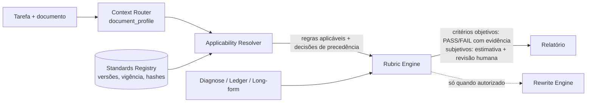

# Visão: normas versionadas, inteligência de documento e avaliação por rubricas (linha futura, pós-v0.7)

Responde ao adendo "Versioned Standards, Document Intelligence & Evaluation Framework". Escrito na v0.7 como descoberta, arquitetura proposta e backlog.

> **Estado em `dev/v0.8.0` (CP10–CP11):** ST-01, ST-02, ST-04 e ST-05 estão implementados e testados; ST-03 em parte; ST-06..ST-08 não. Piloto Enem com fontes reais em nível `SOURCE_CITED` (sem hash do PDF); piloto acadêmico NOT_RUN. O que existe, com que fontes e com que limites: [`v08/DOCUMENT_STANDARDS.md`](../releases/v0.8/DOCUMENT_STANDARDS.md). O restante deste documento continua sendo a visão original, mantida como registro.

## 1. Visão

Analisar, auditar, revisar e, quando autorizado, gerar documentos segundo as regras **aplicáveis à tarefa** (edital, norma, manual, rubrica, template), sabendo de onde cada regra vem, de que versão, se vale para aquela data e com que evidência o texto a atende. Não decorar bons textos; entender critérios. Sem arquitetura amarrada a ENEM, ABNT ou a uma instituição: ENEM e trabalhos acadêmicos são pilotos.

## 2. Auditoria de reuso (o que a v0.7 já oferece)

| Necessidade | Componente existente | Reuso |
|---|---|---|
| Registro versionado de fontes com URL, hash, verificação datada, direitos por operação | Corpus Registry (`voznativa/corpus/registry.py`, `policy.py`, `verify.py`) | o Standards Registry deve seguir o mesmo contrato (YAML por fonte, escada de status, `text_rights`), não um mecanismo novo |
| Perfil externo do documento | Context Contract v3 (`router.py`: 14 dimensões com `value/source/confidence`) | acrescentar um bloco opcional `document_profile` sem semântica no núcleo |
| Critério com evidência e localização | diagnósticos tipados (`diagnose.py`: classe, severidade, confiança, offsets, ação) | forma de saída de um critério de rubrica |
| Estrutura do documento | `longform.py`, `document.py` (blocos, unidades, inventário) | seções exigidas, limites de tamanho |
| Fundamentação em fontes autorizadas | `project.ground`, `diagnose._grounding` | regras de citação/referência existentes vs inventadas |
| Geração → validação → revisão | `engine.rewrite`/`rewrite_document` com gates e juiz | o ciclo do adendo já é o do engine; falta o avaliador de rubrica |
| Modos editoriais | `diagnose.MODES` | REVIEW = auditoria por rubrica sem alterar |

## 3. Arquitetura proposta

- **Standards Registry**: um manifesto por norma/edital/rubrica/template: organização, identificador, versão/edição/revisão, publicação, vigência, edição do evento, data de consulta, hash do documento, autenticidade/acesso, direitos, relação com versões anteriores, regras adicionadas/alteradas/revogadas, exceções, testes de conformidade, limites.
- **Applicability Resolver**: dado instituição, evento, ano/edição, data de submissão, tipo de documento e requisitos do usuário, decide quais regras valem; distingue "mais recente" de "aplicável"; estados `CURRENT`, `APPLICABLE`, `UNKNOWN`, `STALE`, `CONFLICTED`, `BLOCKED` exigem evidência; nunca usa silenciosamente uma edição anterior.
- **Precedência**: registrada por decisão (documentos envolvidos, vigência, autoridade, escopo, justificativa), com revisão humana quando não fundamentável; nenhuma ordem fixa embutida.
- **Rubric Engine**: critério = id, fonte, versão, período, descrição, evidência esperada, regras objetivas verificáveis, regras subjetivas (estimativa, nunca booleano artificial), peso só se oficial, severidade, localização, confiança, necessidade de revisão humana. Notas automáticas rotuladas como estimativa sem calibração independente.

## 4. Inventário inicial de fontes normativas (não verificado)

| Fonte | O que confirmar antes de usar | Estado |
|---|---|---|
| INEP — matriz de referência e cartilha da redação do ENEM, por edição | ano da prova × ano da cartilha × ano das redações exemplares; competências e critérios de nota zero de cada edição; direitos sobre redações exemplares | NOT_VERIFIED |
| ABNT — normas de referências, citações, trabalhos acadêmicos, resumos, artigos | número e ano da edição vigente na Coleção ABNT; licença de uso (normas ABNT são pagas: só metadados e regras parafraseadas) | NOT_VERIFIED |
| Manuais institucionais e editais de eventos (ex.: iniciação científica) | edição, vigência, exceções às normas gerais | NOT_VERIFIED |
| Diretrizes de periódicos | versão e data; política de IA e de dados | NOT_VERIFIED |

Nenhuma versão é citada aqui como vigente: o primeiro trabalho da linha é verificá-las na fonte oficial, com data e hash.

## 5. Matriz de requisitos (proposta)

| ID | Requisito | Aceite |
|---|---|---|
| ST-01 | Standards Registry com o contrato do Corpus Registry | validação estrita; status só com evidência |
| ST-02 | Applicability Resolver | replay histórico: submissão de 2023 usa a regra de 2023 mesmo existindo a de 2025 |
| ST-03 | Registro de precedência | conflito sem fundamento → revisão humana, nunca escolha silenciosa |
| ST-04 | `document_profile` no Context Contract | sem efeito quando ausente (compatibilidade v3) |
| ST-05 | Rubric Engine | critérios objetivos com evidência e offsets; subjetivos como estimativa rotulada |
| ST-06 | Análise de exemplares | separa regra oficial, característica observada, preferência de avaliador e hipótese; nada copiado para geração |
| ST-07 | Gerar → criticar → revisar | parada quando não há ganho ou surge regressão; autoavaliação nunca chamada de independente |
| ST-08 | Temas e exercícios sintéticos | rotulados sintéticos; nunca apresentados como previsão de prova |

## 6. Plano de testes e benchmarks

Replay histórico, cross-version, cross-institution, leave-one-document-type-out; norma atualizada, template substituído, edital trocado, regras conflitantes, documento histórico correto pela norma antiga, fonte desatualizada/indisponível/não oficial, textos excelentes com estruturas diferentes, textos ruins formalmente corretos, revisão que melhora um critério e piora outro, geração que cumpre formato e inventa fatos, referências inexistentes. Conjuntos congelados independentes; nenhum baseline atualizado para esconder regressão.

## 7. Integração com o Rewrite Engine

O Rubric Engine produz diagnósticos no formato de `diagnose.py`; o Planner trata critérios objetivos violados como achados; o engine só reescreve no modo autorizado; a validação global continua sendo o `compare` + guards; o relatório separa conformidade formal, qualidade editorial, solidez argumentativa e evidência científica.

## 8. Riscos

- **Licenciamento**: normas ABNT e redações de terceiros têm direitos; registrar metadados e paráfrases, nunca redistribuir o texto.
- **Integridade acadêmica**: o sistema não promete aprovação, nota nem aceitação; rotula estimativas; não gera dados, resultados, aprovações éticas ou referências.
- **Desatualização**: toda regra tem data de verificação; vencida → `STALE`.
- **Sobreajuste**: um exemplar excelente nunca vira template.

## 9. Validação independente

Comparar com correções oficiais publicadas (quando legalmente disponíveis) e com avaliadores humanos independentes; medir concordância, erros por categoria, estabilidade entre versões; separar avaliação oficial, humana independente, de outro modelo e autoavaliação.

## 10. Backlog priorizado (risco × valor)

1. ST-01 + ST-04 (base, baixo risco, reaproveita contratos existentes).
2. ST-02/ST-03 com replay histórico (alto valor, depende de fontes verificadas).
3. ST-05 com critérios objetivos apenas (estrutura, limites, citações existentes).
4. Piloto ENEM com fontes verificadas e direitos esclarecidos; piloto acadêmico.
5. ST-06/ST-07/ST-08 (exigem avaliadores humanos para não virar autoavaliação).
