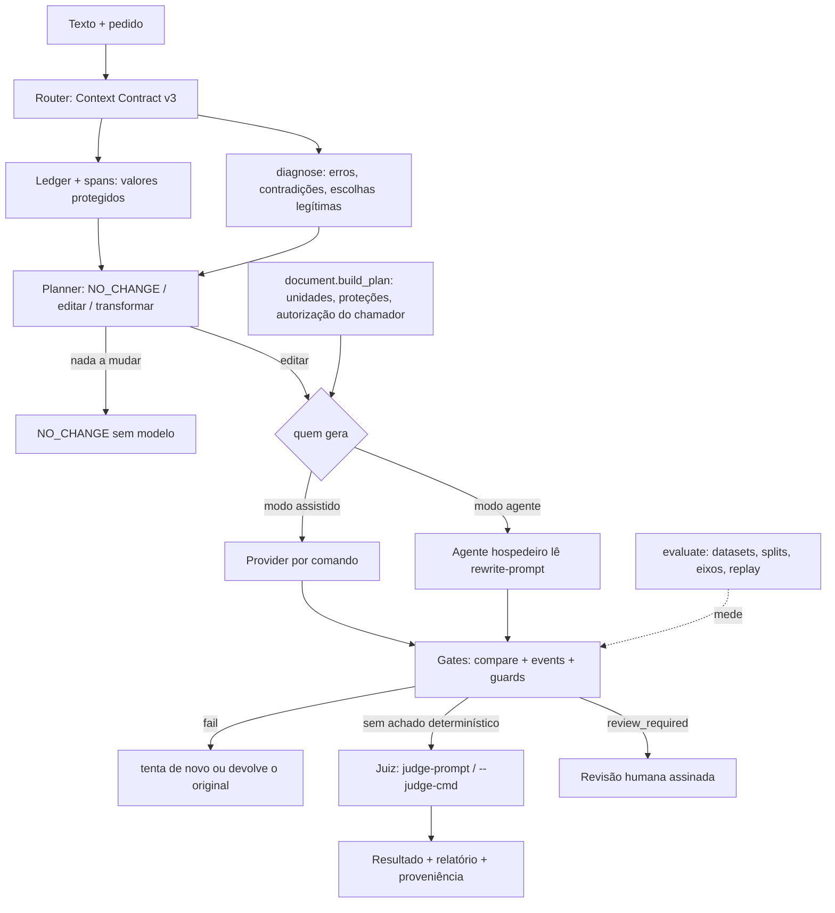

# Arquitetura da v0.8

O que está implementado em `dev/v0.8.0` (com o CP em que entrou) e o que é plano. Fonte das versões anteriores: [`../ARCHITECTURE_AND_RESEARCH.md`](../ARCHITECTURE_AND_RESEARCH.md) e [`../DESIGN_SPEC.md`](../DESIGN_SPEC.md); a consolidação desses documentos é trabalho do CP12.

## 1. Três modos de operação

| Modo | Quem decide | Chama modelo? | Interface | Estado |
|---|---|---|---|---|
| **Determinístico / offline** | regras versionadas, com abstenção | nunca | CLI (`compare`, `diagnose`, `plan`, `route`, `evaluate`, `doctor`, `demo`) e Python | IMPLEMENTED |
| **Assistido por modelo** | o engine: gera com um provider autorizado, valida com os gates, tenta de novo ou devolve o original | sim, só com `--cmd`/`--emulate` | `voznativa rewrite`, `engine.rewrite`, `engine.rewrite_document` | IMPLEMENTED; com provider real: NOT_RUN nesta rodada (sem autorização de custo) |
| **Conduzido por agente** | o agente hospedeiro interpreta contexto, intenção e voz, propõe e critica; o VozNativa dá os contratos, as evidências e os gates | o próprio agente é o modelo | `SKILL.md` → `route`, `plan`, `rewrite-prompt`, `compare`, `judge-prompt`, `diagnose`, `ground` | IMPLEMENTED como procedimento; validação com agente real: NOT_RUN (ver §5) |

Os três usam os mesmos gates. O modo offline continua inteiro sem modelo; os outros dois não o substituem nem o enfraquecem.

## 2. Fluxo

## 3. Componentes e contratos (estado em `dev/v0.8.0`)

| Componente | Módulo | Contrato público | v0.8 |
|---|---|---|---|
| Valores protegidos | `spans.py` | `extract(text)` | CP2: sem custo quadrático, saída idêntica |
| Análise verbal | `morph.py` | `analyse_word`, `verbs`, `constructions` | CP2: memo e ordem estável |
| Gate semântico | `compare.py` | `compare(original, candidate)` → status e issues; exit codes do CLI | CP6: quadros de evento; CP7a: alinhamento sem negação "movida" falsa; CP7b: índices exatos |
| Quadros de evento | `events.py` + `data/verb_relations.json` | `frames(sentence)`, `converse(a, b)` | CP6, novo |
| Plano de documento | `document.py` | `build_plan`, `validate_plan(..., verse_explicit)`, `reassemble(..., verse_explicit)` | CP1: autorização do chamador |
| Reescrita | `engine.py` | `rewrite`, `rewrite_document(..., resume)`, `skill_prompt` | CP1: `resume` não é autoridade; CP5: `skill_prompt`; CP7b: limite de tempo na validação global |
| Avaliação | `evaluation.py`, `arms.py` | `voznativa.eval_dataset` / `eval_run` v1; `evaluate`, `--verify`, `--replay` | CP4/CP5, novo |
| Primeiro uso | `onboarding.py` | `doctor`, `demo` | CP3, novo |
| Juiz | `judge.py` | `prompt`, `validate` (kind `llm`/`human`, `judge_id`, vínculo por sha256) | sem mudança; ver lacuna em §5 |

Tipos de evidência distintos no registro: resultado determinístico (`compare`, `ENGINE_EXECUTED`), inferência de modelo (`kind: llm`, com `judge_id`), decisão humana (`kind: human`, assinada por `voznativa review`), e o que nenhum executou (`NOT_RUN`).

## 4. Fronteiras de confiança

- Texto do usuário, corpora, documentos e respostas de modelo são **dados**: o prompt cerca o texto (`<<<TEXTO#hash`), candidatas com tokens de protocolo são reprovadas, planos e registros serializados não concedem permissão (CP1).
- Autorização para reescrever verso vem do chamador; código, tabela, citação e separador nunca vão ao modelo.
- Rede só com provider explícito; `doctor` e `demo` nunca usam rede.

## 5. Agent-Led Runtime & Skill Validation

**O que existe.** O `SKILL.md` dá ao agente hospedeiro um procedimento: montar o contrato (`route`), decidir se há o que fazer (`plan`), obter o prompt que o engine mandaria (`rewrite-prompt`, idêntico a `engine.skill_prompt`, CP5), escrever a candidata, passá-la pelo gate (`compare`), pedir julgamento (`judge-prompt`) e decidir; `diagnose` e `ground` dão erros do original e fundamentação em fontes. O agente pode propor melhorias que os detectores não preveem; a aplicação continua condicionada ao gate e, quando houver mudança de fato, à autorização do usuário. Uma chamada de LLM com ferramentas desligadas (o modo assistido com `--cmd`) **não** é o modo conduzido por agente.

**Lacuna encontrada no CP7 (V08-GAP-16).** O contrato do juiz registra `kind` e `judge_id`, mas não se o juiz é o mesmo agente que escreveu a candidata. No modo Skill isso é o caso comum, e um "equivalent" vira `accepted_by_llm`, o mesmo rótulo de um modelo independente. **Corrigida antes do piloto agent-led:** o juízo carrega `generator_relation`; `same_agent` + equivalent é registrado como `agent_assessment` (AGENT_OBSERVED) e não aprova nada; o engine marca `same_agent` quando o juiz é o próprio gerador (mesmo objeto ou mesma linha de comando); o `SKILL.md` instrui o agente a declarar a relação.

**Validação.**

| Cenário E2E | Estado |
|---|---|
| CLI offline, sem modelo | executado na suíte (`test_v08_dx`, `test_readme`, smoke do wheel) |
| Rewrite Engine com stub determinístico (contrato) | executado (`test_document_rewrite`, `test_v08_longform`, braços B4/B5 com `SYNTHETIC_FIXTURE`) |
| Rewrite Engine com provider real | NOT_RUN: precisa de autorização de custo (CP9) |
| Agent Skill operada por agente real | NOT_RUN: idem; cenários e limites preparados no CP9 |
| Juiz, revisão e correção de candidata rejeitada com modelo real | NOT_RUN: idem |
| Documento longo e ambiguidade, `NO_CHANGE` legítimo, falha de provider, credencial ausente, orçamento, abstenção | executados com stubs nas suítes; com provider real: NOT_RUN |

Avaliações feitas por este agente durante o desenvolvimento são **agent assessment**, nunca avaliação humana ou independente.

## 6. Planejado (não implementado)

Standards Registry, Applicability Resolver e Rubric Engine (CP10/CP11, a partir de [`../V08_STANDARDS_VISION.md`](../V08_STANDARDS_VISION.md)); avaliadores por eixo de qualidade e curva do Router (CP8); braços com provider real e revisão humana (CP9, com autorização).
